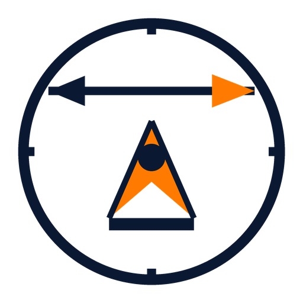

<p align="center">
  
</p>

<h1 align="center">designvane</h1>

<p align="center">
  <strong>Design-to-code Agent Skills that work in any coding agent — no vendor account, no hosted MCP server, no API key.</strong>
</p>

<p align="center">
  Works with Claude Code, Codex, Cursor, Gemini CLI, OpenCode, and Copilot.
</p>

<p align="center">
  
  
  
  
  
</p>

---

## What is this?

designvane is a library of **18 Agent Skills** for design-to-code work,
organized as **3 plugins**. Every skill follows the open
[Agent Skills](https://agentskills.io) standard: a `SKILL.md` with
kebab-case name and description, plus a worked example and a
checklist/template in every folder.

The skills cover the whole path from idea to shipped UI:

- **Design** — specify screens, polish prompts, build token systems,
  author or extract a `DESIGN.md`, critique existing UI, define
  responsive behavior.
- **Build** — implement the design in React, Vue, HTML/Tailwind, or
  React Native, with dashboard and form patterns that carry the rules
  most implementations get wrong.
- **Utilities** — export static HTML, audit accessibility against
  WCAG 2.2 AA, add dark mode properly, govern icons, and give motion
  a vocabulary.

Everything runs from the brief, your repo, and your `DESIGN.md`.
There is nothing to sign up for and nothing phoning home.

## Why vendor-neutral?

Most design-skill libraries are front-ends for one vendor's hosted
design tool: the skills stop working without that vendor's server,
account, and credentials, and the naming conventions leak the vendor
into your project (breaking some agents outright).

designvane takes the opposite bet:

| | designvane | Vendor-locked skill libraries |
|---|---|---|
| Account required | None | Vendor account + credentials |
| Hosted server required | None — skills run locally in your agent | Vendor MCP server must be configured |
| API key | None | Usually required |
| Works offline | Yes | No |
| Agent compatibility | Claude Code, Codex, Cursor, Gemini CLI, OpenCode, Copilot | The vendor's supported list |
| Skill naming | Pure kebab-case, matches folders exactly | Often prefixed names that some agents reject |
| Design source | Your brief, your repo, your DESIGN.md | The vendor's canvas |
| Switching cost | Delete a folder | Rebuild your workflow |

Vendor-neutral also means the skills compose: `generate-screen`
writes a spec that `react-components` implements, `design-critique`
reviews, and `accessibility-audit` verifies — with no service in
the middle.

## Quickstart

One command installs every skill into your current project for
Claude Code:

```bash
python3 designvane.py install --target claude-code
```

That's it. Open your agent and ask for the work ("design a pricing
screen", "audit this checkout for accessibility") — the matching
skill loads automatically from its description.

Other agents, same idea:

```bash
python3 designvane.py install --target codex
python3 designvane.py install --target cursor
python3 designvane.py install --target opencode
python3 designvane.py install --target agents   # generic .agents/skills
```

## Install

### Per-agent targets

| Agent | Project scope | Global scope |
|---|---|---|
| Claude Code | `.claude/skills/` | `~/.claude/skills/` |
| Codex | `.codex/skills/` | `~/.codex/skills/` |
| Cursor | `.cursor/skills/` | `~/.cursor/skills/` |
| OpenCode | `.opencode/skills/` | `~/.config/opencode/skills/` |
| Generic agents | `.agents/skills/` | `~/.agents/skills/` |

Add `--scope global` for the global column. Add `--plugin <name>`
to install one plugin, or `--skill <name>` for a single skill:

```bash
python3 designvane.py install --target claude-code --scope global
python3 designvane.py install --target cursor --plugin designvane-build
python3 designvane.py install --target opencode --skill dark-mode
```

### Plugin marketplace

The repository is also a plugin marketplace
(`.agents/plugins/marketplace.json`) registering all three plugins,
for agents that support marketplace installs:

- `designvane-design` — plan and specify
- `designvane-build` — implement
- `designvane-utilities` — extract, export, harden

### Manual install

A skill is just a folder. Copy any folder under
`plugins/*/skills/` into your agent's skills directory and it works —
the installer is a convenience, not a requirement.

## Catalog

### designvane-design — plan and specify

| Skill | What it does |
|---|---|
| `generate-screen` | Turn a brief into a complete, build-ready screen spec with all states |
| `prompt-polish` | Rewrite vague design prompts into precise, checkable ones |
| `design-tokens` | Build a token system: color, type, spacing, radius, elevation, motion |
| `design-md-author` | Write a DESIGN.md that constrains real decisions, values not vibes |
| `design-critique` | Heuristic critique of a screen with severity-ranked, fixable findings |
| `responsive-layout` | Per-component behavior at every breakpoint, with untouchables protected |

### designvane-build — implement

| Skill | What it does |
|---|---|
| `react-components` | Typed React components, variant maps, all states, accessible markup |
| `vue-components` | Vue 3 SFCs with script setup, typed props/emits, slot composition |
| `html-tailwind` | Semantic HTML + Tailwind constrained by the token theme |
| `react-native-ui` | Native-feel RN screens: safe areas, 44pt targets, virtualized lists |
| `dashboard-charts` | Dashboards that answer questions; honest KPIs; the right chart per data shape |
| `form-patterns` | Forms people finish: grouping, validation timing, humane error copy |

### designvane-utilities — extract, export, harden

| Skill | What it does |
|---|---|
| `design-md-extract` | Mine an existing codebase into the DESIGN.md it never wrote down |
| `html-export` | Faithful, self-contained static HTML exports that work offline |
| `accessibility-audit` | WCAG 2.2 AA audit with criterion-mapped, concrete fixes |
| `dark-mode` | Real dark themes at the token layer — not inversion |
| `icon-system` | One grid, one stroke, one inventory: icons that look like family |
| `motion-design` | A motion vocabulary with jobs, durations, easings, reduced-motion twins |

## Anatomy of a skill

Every skill folder contains:

```
skill-name/
├── SKILL.md          # frontmatter (name, description) + workflow, rules, checklist
├── examples/         # one gold-standard example to imitate
└── resources/        # one checklist, template, or reference
```

Names are pure kebab-case and always equal the folder name, so every
agent that implements the standard — including OpenCode — loads them
without renaming.

## Validate

The repo ships its own validator and test suite (Python standard
library only):

```bash
python3 designvane.py validate   # structure, frontmatter, naming, completeness
python3 designvane.py list       # the catalog, from the folders themselves
python3 designvane.py selftest   # built-in smoke tests
python3 selftest.py              # full suite: catalog, tamper tests, installs
```

CI (`.github/workflows/validate-skills.yml`) runs all of these on
every push and pull request, so a malformed skill cannot merge.

## The DESIGN.md workflow

The skills are designed around one shared file: `DESIGN.md` at your
repo root. Start a project with `design-md-author` (or
`design-md-extract` for an existing product), and every other skill
reads its tokens, component rules, and voice guidance before working.
One file keeps eighteen skills consistent.

## Bahasa Indonesia (ringkas)

designvane adalah pustaka 18 Agent Skills untuk pekerjaan
design-to-code yang **netral vendor**: tanpa akun, tanpa server MCP
milik vendor, tanpa API key. Skill bekerja dari brief, repo, dan
DESIGN.md Anda, dan kompatibel dengan Claude Code, Codex, Cursor,
Gemini CLI, OpenCode, dan Copilot. Instal satu perintah:
`python3 designvane.py install --target claude-code`. Semua skill
mengikuti standar terbuka Agent Skills, bernama kebab-case, dan
divalidasi otomatis oleh CI.

## Contributing

See [CONTRIBUTING.md](CONTRIBUTING.md). In short: keep names
kebab-case, keep skills self-contained, and `python3 selftest.py`
must pass.

## License

Apache License 2.0 — see [LICENSE](LICENSE). The skills are original
works written for this repository; the Agent Skills format itself is
an open standard.
